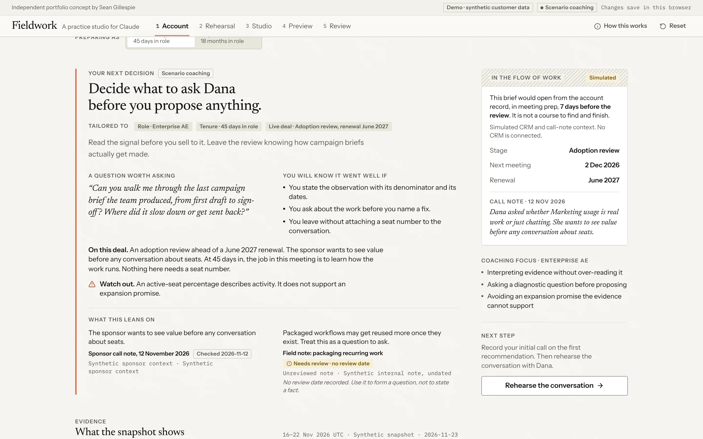
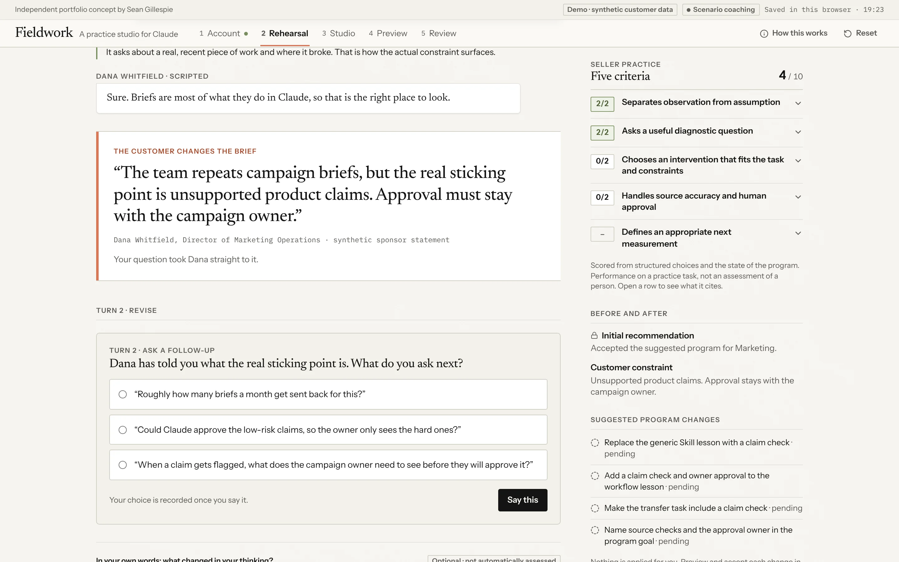
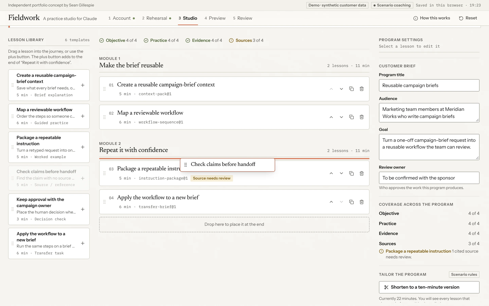
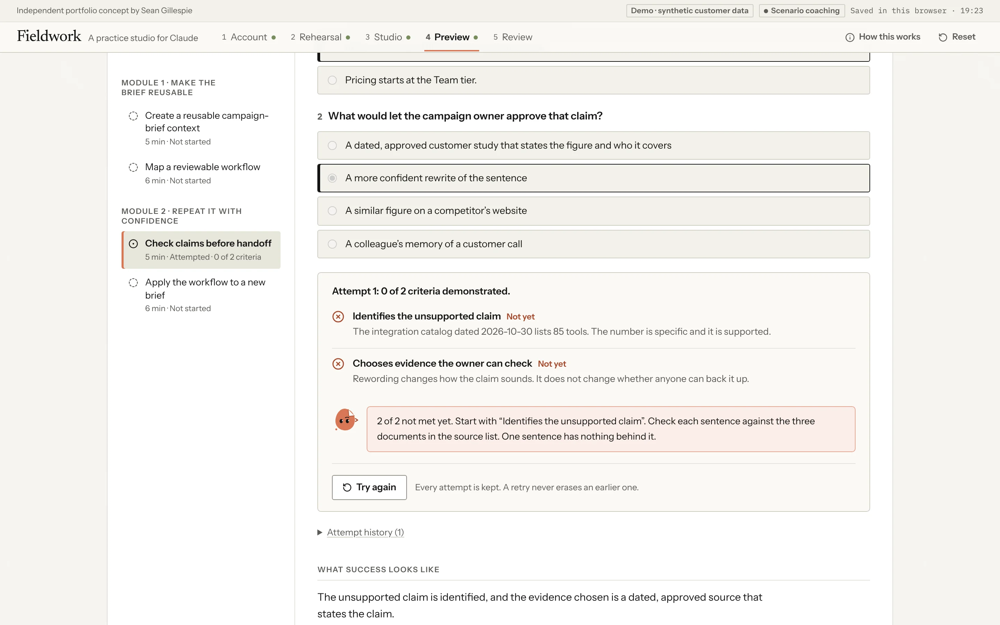
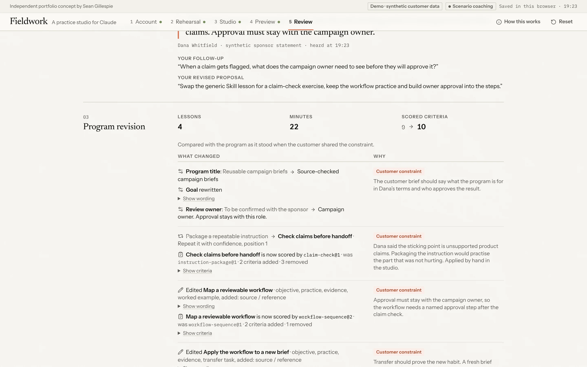

# Fieldwork

A practice studio for Claude. Independent portfolio concept by Sean Gillespie.

Fieldwork helps a seller or CSM turn an account's adoption signals into a better customer conversation, a tailored learning program and evidence that the customer can do useful work. It runs one complete journey on one synthetic account, Meridian Works.

This is a working product prototype with simulated coaching. It is not an Anthropic product, it uses no customer data and it makes no model call at runtime. `EVIDENCE.md` says exactly what is synthetic, what is scripted and what has not been tested.



## The journey

The app opens on the account mission and walks through seven steps in five views.

| View      | What happens                                                                                              |
| --------- | --------------------------------------------------------------------------------------------------------- |
| Account   | Inspect the synthetic snapshot, read each recommendation as a hypothesis and record an initial call.      |
| Rehearsal | Practise a two-turn conversation with a scripted sponsor. The customer changes the brief partway through. |
| Studio    | Revise the learning program by drag and drop, editing and previewed changes.                              |
| Preview   | See the program exactly as the customer would, and complete the applied lab.                              |
| Review    | Compare the plan before and after, read both sets of practice criteria and export the plan.               |

| The customer changes the brief                                                                        | Revising by drag and drop                                                                             |
| ----------------------------------------------------------------------------------------------------- | ----------------------------------------------------------------------------------------------------- |
|  |  |

| Learner feedback by criterion                                                                                           | What changed and why                                                                    |
| ----------------------------------------------------------------------------------------------------------------------- | --------------------------------------------------------------------------------------- |
|  |  |

Screenshots were captured from the production build on 2026-11-25. More are in `docs/screenshots/`.

## Run it locally

Node 22.12 or newer is required.

```bash
npm install
```

```bash
npm run dev
```

The dev server runs at `http://localhost:5173`. No environment variables, credentials or network access are needed.

## Build and preview

```bash
npm run build
```

```bash
npm run preview
```

The production build is written to `dist/` and the preview server runs at `http://localhost:4173`.

## Tests

```bash
npm test
```

runs the unit tests (Vitest) for the recommendation rules, denominator handling, scoring, state transitions, exports and colour contrast.

```bash
npm run test:e2e
```

builds the app and runs the browser tests (Playwright, Chromium) for the golden path, the phone layout and an axe-core accessibility check. On a fresh machine, install the browser once first:

```bash
npx playwright install chromium
```

`npm run check` runs the typecheck, the unit tests and the build together.

## Hosting

The build is a static site with hash-based navigation, so it needs no server and no rewrite rules. Nothing has been published. No hosting account, domain or repository connection has been created.

For Cloudflare Pages, or any equivalent static host:

| Setting               | Value           |
| --------------------- | --------------- |
| Build command         | `npm run build` |
| Output directory      | `dist`          |
| Node version          | 22              |
| Environment variables | None            |

`public/_headers` sets a content security policy and cache headers in the format Cloudflare Pages reads. Other hosts ignore it, and the app works without it. The build uses relative asset paths, so it also runs from a subpath.

The smallest next step toward a public URL is listed at the end of `EVIDENCE.md`.

## Demo switches

Append `?simulate=analytics-unavailable` to the URL to see how the app behaves when the analytics snapshot cannot be loaded. It is a reviewer aid and is not linked from the interface.

Reset lives in the header. It clears everything stored in the browser, or the program only.

## Project layout

```
src/
  types.ts          App-owned schemas. Not Anthropic API shapes.
  fixtures/         Synthetic account, members, lessons, assessments, script, knowledge pack.
  rules/            Pure functions: analytics, recommendations, scoring, program edits, tailoring, exports.
  state/            One reducer, versioned local persistence, derived account data.
  providers/        Analytics and coaching boundaries. One working provider each.
  components/       Views and UI. No business rules live here.
  styles/           Design tokens and base styles.
tests/e2e/          Browser tests.
docs/               Integration boundaries that are documented but not built.
```

## Further reading

- `DESIGN.md` covers tokens, layout and interaction decisions.
- `EVIDENCE.md` separates synthetic data, scenario coaching, optional live behaviour and untested outcomes.
- `DECISIONS.md` is the log of decisions actually made during the build.
- `WALKTHROUGH.md` is a 90-second demonstration script.
- `AUTHORSHIP.md` records who did what.
- `docs/ANALYTICS_INTEGRATION.md` and `docs/LIVE_COACHING.md` describe the two proposed integrations.
